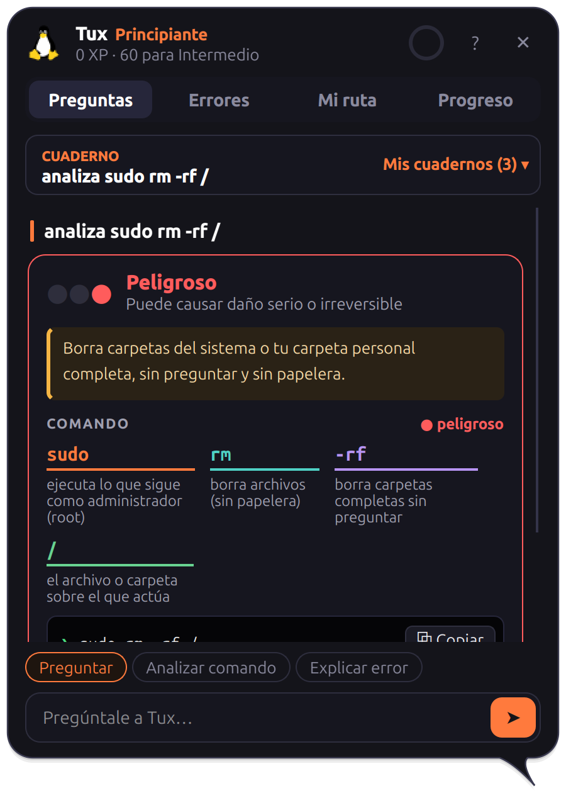
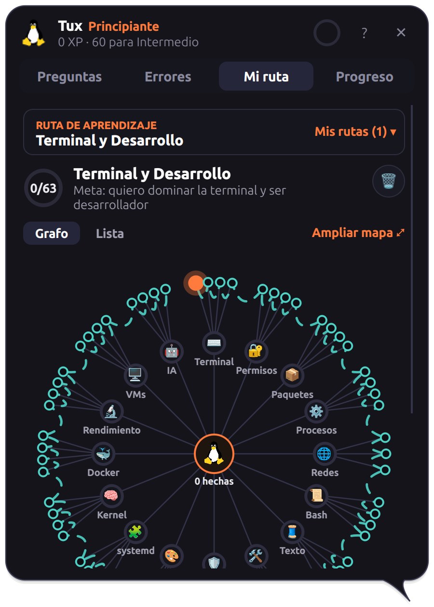
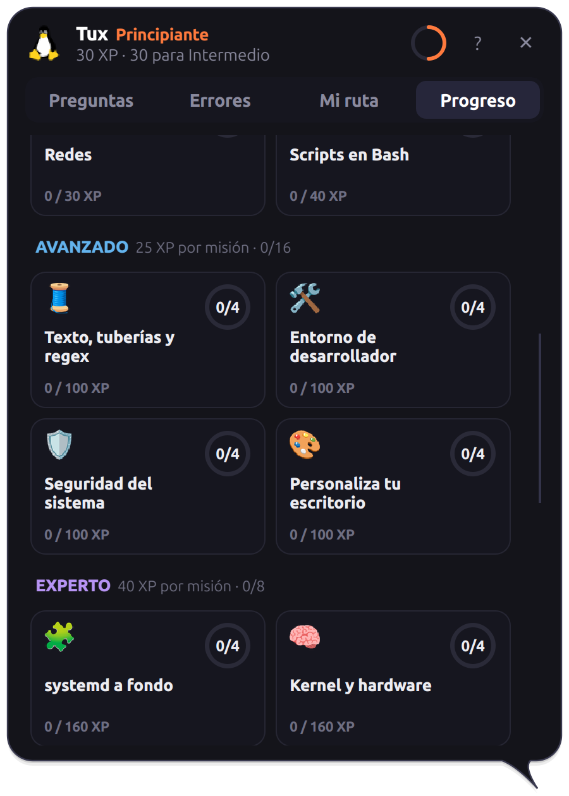

<p align="center">
  
</p>

<h1 align="center">Tux Assistant</h1>

<p align="center">
  <b>Un compañero de escritorio que te enseña Linux mientras lo usas.</b><br>
  Explica antes de que ejecutes, revisa tus errores en la terminal y arma tu ruta de estudio, con IA que corre en tu propio equipo.
</p>

<p align="center">
  
  
  
  
</p>

---

## Video

<p align="center">
  <a href="assets/tux_assistant_promo.mp4">
    
  </a>
  <br>
  <a href="assets/tux_assistant_promo.mp4"><b>▶ Ver el video completo (30 s, con sonido)</b></a>
</p>

---

## El problema

Pasarse a Linux no debería dar miedo, pero para mucha gente lo da. Cuando aparece un error o hay que instalar algo, la ayuda casi nunca está donde ocurre el problema: hay que salir a buscar en foros o videos, copiar un comando que no se entiende del todo y esperar que funcione en *tu* distribución. Así se resuelve la tarea, pero no se aprende nada, y a veces se rompe algo.

Tux Assistant nace como proyecto de la asignatura **Gestión de Tecnología e Innovación** (Universidad El Bosque) para probar otra idea: un asistente integrado al escritorio que acompañe el aprendizaje en el mismo lugar donde surge la duda, con información real del equipo y priorizando que la persona entienda, no solo que copie.

## Qué hace

**Pregunta rápida (un clic en Tux).** Escribes la duda y la respuesta sale completa y corta en su globo, con los datos reales de tu PC medidos en ese momento.

**Cuaderno (doble clic).** Explicaciones completas en tarjetas: qué está pasando, el comando desarmado parte por parte, un botón para copiarlo y una pregunta para comprobar que lo entendiste. Puedes tener varios cuadernos y Tux les pone nombre según el tema.

**Semáforo de riesgo.** Pegas un comando que encontraste en internet y Tux te dice si es seguro, si hay que tener cuidado o si es peligroso. Esa decisión la toman reglas fijas, no la IA.

**Vigilancia de la terminal (opcional).** Si un comando falla en bash, Tux aparece y explica qué pasó, corrige lo que escribiste mal (`apd` → `apt`) y te recomienda la lección que evita ese error. La pestaña Errores lleva un resumen de tu semana.

**Mi ruta de aprendizaje.** Le dices tu meta y la IA arma un plan con temas de un catálogo de 16 (desde la terminal hasta systemd, Docker, máquinas virtuales e IA local). Cada lección termina en una misión de varios pasos que Tux **comprueba en tu equipo**. Las rutas son independientes y se ven en un grafo que se arma en vivo.

**Progreso.** Cada misión da XP según su dificultad y con eso subes de nivel, de Principiante a Arquitecto Linux. Aparte eliges cómo quieres que Tux te explique: paso a paso, explicado, al grano o técnico.

<p align="center">
  
  
  
</p>
<p align="center">
  
  
  
</p>

## Cómo funciona por dentro

- **Interfaz:** Python + PyQt5. Tux es una ventana flotante animada; el cuaderno es un globo de diálogo que siempre aparece arriba o abajo de él.
- **IA local:** [Ollama](https://ollama.com) con el modelo `qwen3:4b-instruct` (cuantizado, unos 2,5 GB). Nada sale de tu equipo.
- **Contexto real:** antes de responder se miden datos del sistema (RAM, disco, red, servicios, programas instalados) solo con comandos de lectura. La IA puede pedir consultas adicionales, pero pasan por una lista blanca: sin `sudo`, sin modificar nada y sin tocar rutas sensibles.
- **Misiones:** las redacta la IA para cada ruta, pero las comprueba código determinista (existe el archivo, los permisos son 600, el programa está instalado…).
- **Datos:** chats y progreso en JSON en `~/.config/tux-assistant` (pocos KB).

## Instalación

Un solo comando instala todo: paquetes del sistema, Python y sus librerías, Ollama, el modelo, el acceso directo y el comando `tux-assistant`.

```bash
curl -fsSL https://raw.githubusercontent.com/SergiusYT/Tux_Assistant/main/instalar.sh | bash
```

Si ya clonaste el repositorio: `bash instalar.sh`. Funciona con apt, dnf, pacman y zypper. Opciones y desinstalación en [INSTALACION.txt](INSTALACION.txt).

**Requisitos:** Linux de escritorio, ~8 GB de RAM (con GPU va más rápido) y unos 4 GB de disco para el modelo.

## Uso

| Acción | Resultado |
|---|---|
| Clic en Tux | Pregunta rápida |
| Doble clic | Cuaderno completo |
| Arrastrar | Mover a Tux (camina y el globo lo sigue) |
| Clic derecho | Se despide y cierra todo, incluido el modelo en memoria |

Dentro del cuaderno, el botón **?** muestra la guía completa de controles.

## Equipo

Proyecto de Innovación Tecnológica · Gestión de Tecnología e Innovación · Facultad de Ingeniería, Universidad El Bosque

**Miguel Alvarado · Melanny Jutinico · David Camacho · Sergio Lozano**

Docente: Luis Alejandro López

---

<p align="center"><b>Linux, sin miedo.</b> 🐧</p>
