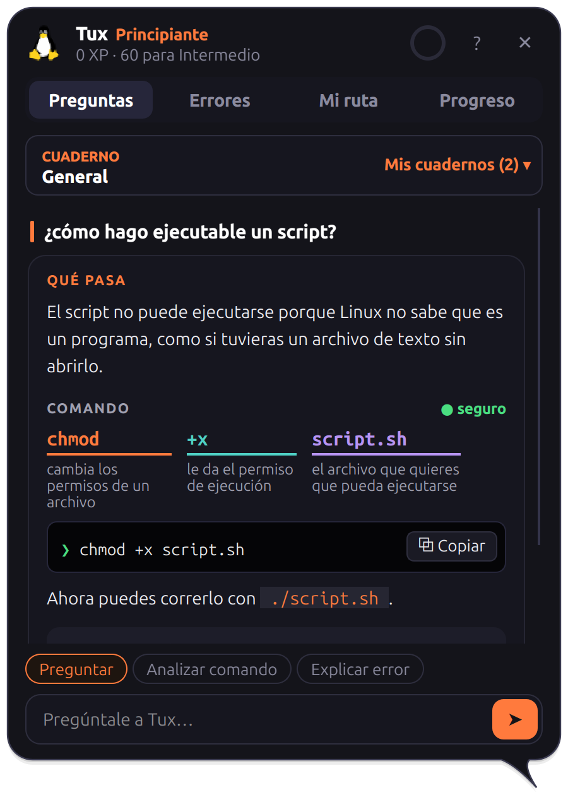
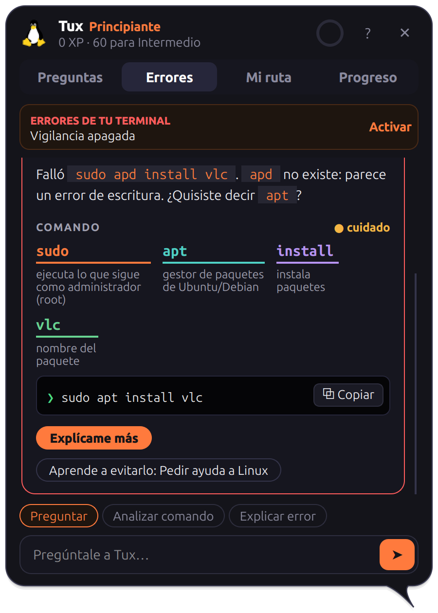
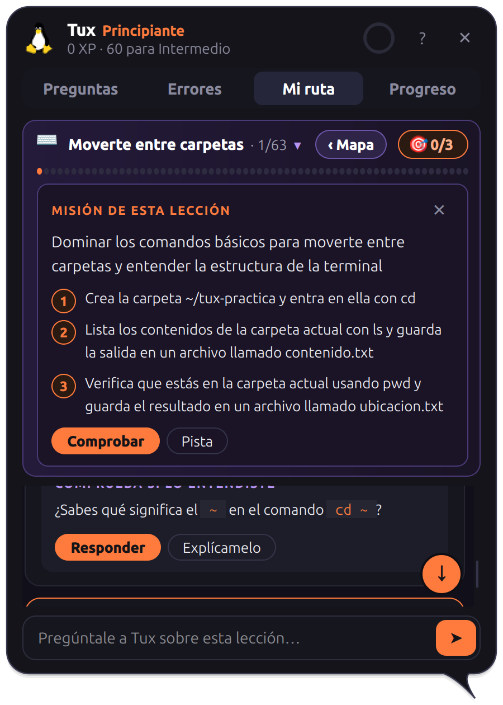

https://github.com/user-attachments/assets/e8fe8e03-386e-47ee-84d8-d8a50263d4a6
<p align="center">
  
</p>

<h1 align="center">Tux Assistant</h1>

<h3 align="center">Aprende Linux entendiendo, no copiando 🐧</h3>

<p align="center">
  
  
  
</p>

<!-- VIDEO -->


https://github.com/user-attachments/assets/75c07f59-32a6-478b-9699-c62a9b46722d

<br>

<table>
  <tr>
    <td align="center" width="33%"><br><b>Te explica cada comando</b><br><sub>parte por parte, con datos reales de tu PC</sub></td>
    <td align="center" width="33%"><br><b>Te avisa si es peligroso</b><br><sub>🟢 seguro · 🟡 cuidado · 🔴 peligroso</sub></td>
    <td align="center" width="33%"><br><b>Corrige tus errores</b><br><sub>Tux aparece cuando falla un comando</sub></td>
  </tr>
  <tr>
    <td align="center"><br><b>Tu ruta, armada por IA</b><br><sub>16 temas, de la terminal a Docker e IA</sub></td>
    <td align="center"><br><b>Misiones reales</b><br><sub>Tux comprueba en tu equipo si las hiciste</sub></td>
    <td align="center"><br><b>Sube de nivel</b><br><sub>de Principiante a Arquitecto Linux</sub></td>
  </tr>
</table>

## ⚡ Instalar (un solo comando)

```bash
curl -fsSL https://raw.githubusercontent.com/SergiusYT/Tux_Assistant/main/instalar.sh | bash
```


Instala todo solo: dependencias, la IA local (Ollama + qwen3) y el acceso directo. Funciona en Ubuntu, Debian, Fedora, Arch y openSUSE.

## 🖱️ Cómo se usa

| | |
|---|---|
| **Clic** en Tux | Pregunta rápida |
| **Doble clic** | Cuaderno completo |
| **Arrastrar** | Mover a Tux |
| **Clic derecho** | Cerrar |

## 🔒 Privado por diseño

La IA corre en tu computador: nada sale a internet. Tux solo **lee** tu sistema, nunca ejecuta cambios por ti.

---

<p align="center">
  <b>Miguel Alvarado · Melanny Jutinico · David Camacho · Sergio Lozano</b><br>
  <sub>Gestión de Tecnología e Innovación · Universidad El Bosque</sub>
</p>

<p align="center"><b>Linux, sin miedo.</b></p>
